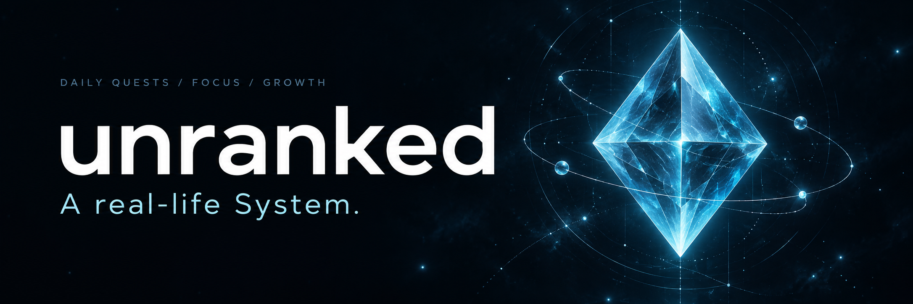
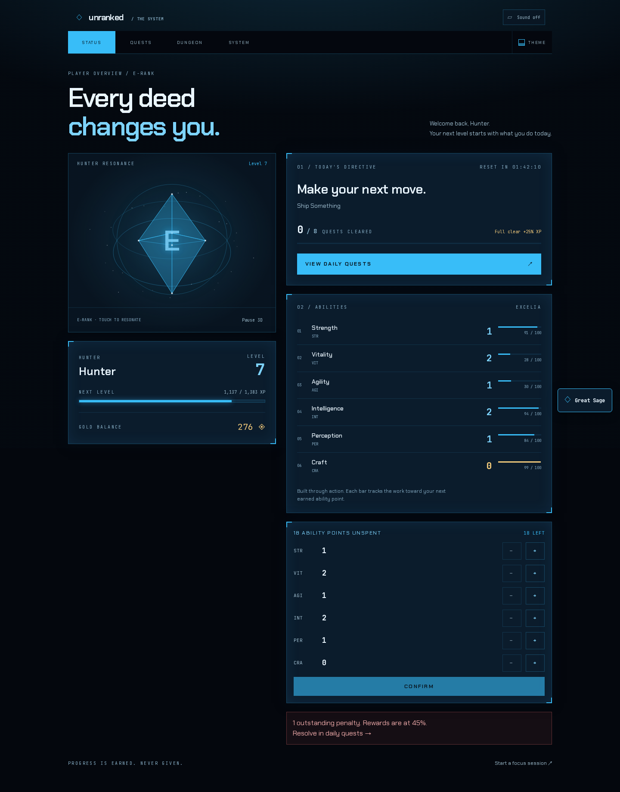
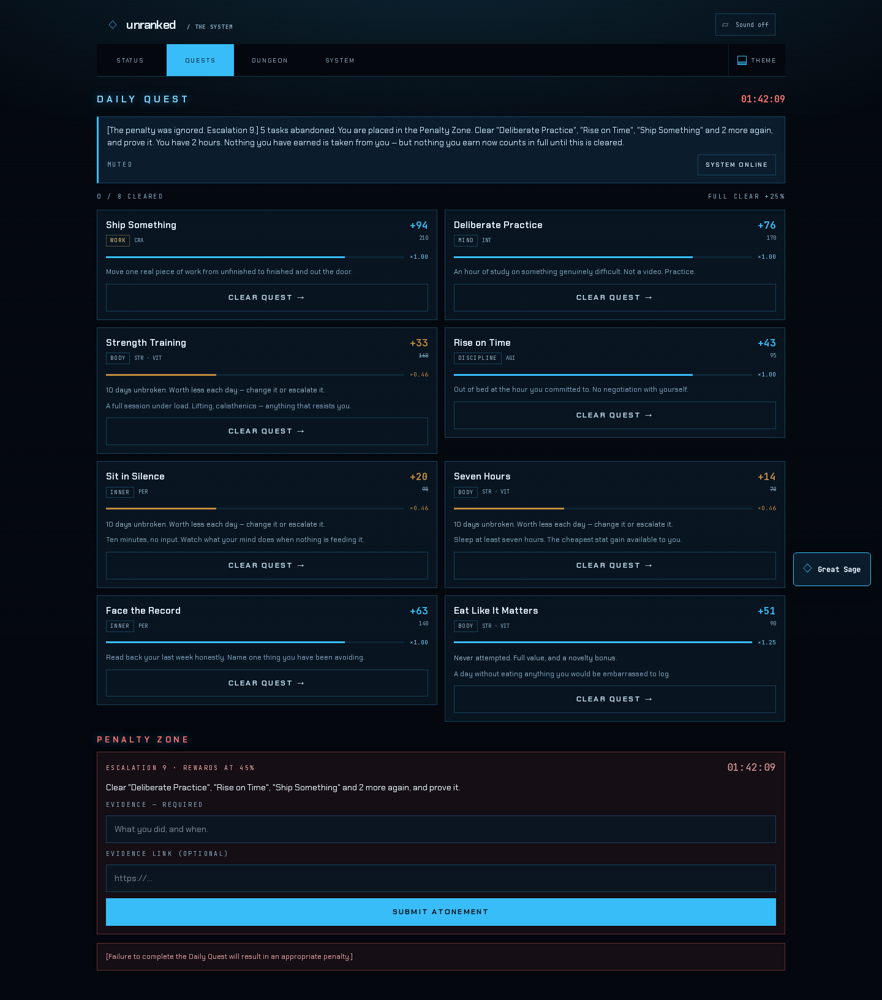
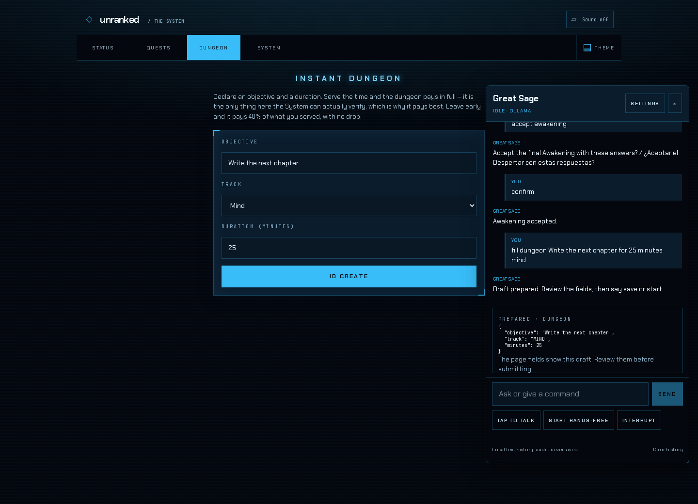
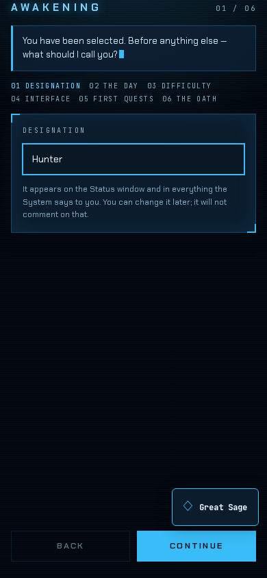
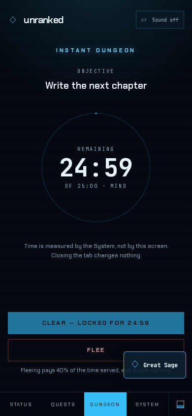

# unranked

A self-improvement app built on the "System" trope from Solo Leveling and its
LitRPG cousins: a window that issues you daily quests, tracks stats, levels you
up, and punishes you for skipping.

Built with **Next.js, React, TypeScript, Drizzle and SQLite**. Run it yourself,
keep your progress on your own machine, and use it from desktop or mobile.

[Get started](#running-it) · [Screenshots](#screenshots) · [Great Sage](#great-sage-assistant) · [Themes](#themes)

## Screenshots

Actual app captures using a separate demo database and the Hologram theme.

**Status — hunter progression, daily directives and six earned abilities.**



| Daily quests | Great Sage assistant |
| --- | --- |
|  |  |
| Rewards change as your practice develops. | Draft an action, review it, then commit. |

<p align="center">
  
  &nbsp;&nbsp;
  
</p>

<p align="center"><em>Awakening and an active Instant Dungeon on mobile.</em></p>

The genre is crowded, and nearly every app in it is XP over a checkbox. The
documented way they all die is that by month two you are managing a character
instead of building habits. So the design goal here is not "add XP to a todo
list" — it is to make the System **escalate**.

## The rule everything rests on

**Repetition pays less.** Complete the same quest on consecutive days and its
value decays geometrically toward a floor. Do something you have never done and
it pays a novelty bonus. Leave a quest alone long enough and it becomes worth
doing properly again.

Every quest card shows what it is worth *right now* — `×0.46` with the original
value struck through — because the mechanic is invisible unless the interface
says it out loud.

The idea is borrowed from DanMachi's *excelia*: doing what you have already
mastered is maintenance, not growth, and the System prices it accordingly. The
floor exists because maintenance is not worthless either.

## What else it takes from the source material

| Mechanic | From | What it does here |
|---|---|---|
| Daily Quest & Penalty Zone | Solo Leveling | A real deadline in your own time zone, and a consequence for missing it |
| Manual stat points | Solo Leveling | Level-ups grant points **you** assign. Never automated — it is the best beat in the genre |
| Instant Dungeon (`ID Create`) | The Gamer | A sealed, timed focus session. The only thing here that is genuinely verified |
| Excelia | DanMachi | Stats grow from the deeds that exercised them, not from a menu |
| Six stats | — | STR VIT AGI INT PER, plus **CRA** (Craft) for work and money |

## Real stakes, recoverable

Penalties sting and escalate while ignored, but **nothing is ever destroyed** —
no lost levels, no lost stats, no lost experience. A penalty reduces what you
earn from now until it is cleared, and clearing it requires evidence: the System
does not take atonement on trust.

Two rules keep this from becoming a punishment treadmill, both written after a
30-day simulation produced 67 concurrent penalties:

- **One penalty per lapse, not per quest.** A bad day is one failure to complete
  the Daily Quest, not five separate atonements.
- **Never more than one open at a time.** You are in the Penalty Zone or you are
  not. Ignoring it escalates the one you have; it never spawns a second.

The debuff is hard-capped, so the hole always has a bottom.

## The first run

Opening the app for the first time is an **Awakening**: six steps, the System
narrating each one, and nothing written until you accept at the end. It asks
for your name, where your day ends, how hard the System is allowed to be, what
the window should look like, and — the step that matters most — which quests it
should ask of you *every* day.

That last one is where the decay rule is explained before it can hurt you.
Choose six dailies and the panel says out loud that repetition will have them
worth a fraction of face value inside a week. Nothing stops you; the System
just refuses to let it be a surprise.

It is one form across six panels, so a half-finished ritual writes nothing at
all — `onboarded_at` stays null and every System route redirects back to it.
Settings can replay it later, which re-asks the questions with your current
answers filled in and touches nothing else: not a level, not the ledger, not a
single piece of evidence.

## Verified, not trusted

Instant Dungeons are the one mechanic the System can actually check. Elapsed
time is derived solely from a persisted start and the server's clock — no client
ever supplies a duration. Closing the tab, reloading, or editing the page does
nothing, which is exactly why dungeons pay the best rate. Everything else is an
honour system, by design.

## Running it

```bash
make setup     # install, create .env.local, migrate, seed
make dev
```

`make` on its own lists every target. The `pnpm` scripts still work if you
prefer them.

It is a PWA. Reach it from your phone over Tailscale or your LAN; the database
is a single SQLite file under `data/`, alongside any evidence you attach.

```bash
make check                            # types, tests, and the layer boundaries
make verify                           # the above, plus a production build
make simulate ARGS="--days 60"        # drive two months through the engine
```

`make simulate` is how balance decisions get made here. It writes to its own
database and refuses to touch the real one without `--force`. It is what caught
the penalty design producing 67 concurrent penalties over a bad month.

`make boundaries` enforces the architecture the tests cannot state: `domain/`
importing nothing but itself, the provider gateways never touching storage, and
no raw colour in a component. It caught the PWA theme colour being pinned to one
theme's palette on its first run.

## Great Sage assistant

The floating Great Sage button opens a persistent English/Spanish assistant,
including during Awakening. It prepares visible form drafts and executes existing
app actions through the same validated services as the buttons. Fleeing, spending
points and final Awakening acceptance require confirmation.

Text works immediately. Open Sage settings to download local Needle/Whistle
speech models and Piper voices, then use Tap to talk or explicitly start a
hands-free conversation. Audio stays in the browser and is never recorded to
storage. Text history persists in SQLite and can be cleared.

Conversation defaults to local Ollama `qwen3.5:4b` with thinking off. WebLLM is
an optional browser alternative. Claude and OpenAI are optional paid API
connections, selected explicitly with keys configured only on the server.

See [assistant setup and commands](docs/assistant/README.md) and the
[verification record](docs/assistant/VERIFICATION.md), including remaining
physical phone checks.

## The System's voice

The System writes and **speaks**. Both come from one stream: text renders token
by token while completed sentences are handed to the voice, so it starts talking
before it has finished thinking.

Two independent gateways, each swappable without touching the other:

- **Text** — `AI_PROVIDER`: `webllm`, `anthropic`, `openai`, `google`, `ollama`,
  any OpenAI-compatible endpoint, or `none`. Settings can change all of this at
  runtime and wins over the environment; the API key is the exception and is
  only ever read from server environment variables (`ANTHROPIC_API_KEY`,
  `OPENAI_API_KEY`, or the compatible `AI_API_KEY` fallback), never stored per-hunter.
- **Voice** — browser speech, local Piper in a worker with downloadable licensed
  voices, or silent. ElevenLabs and OpenAI voice remain unavailable.

`AI_PROVIDER=none` is a fully supported way to run this. The System still speaks
— from its own authored script — and the rules engine never waits on a model to
decide anything numeric.

### In the browser

`webllm` runs a quantised model on your own GPU through
[WebLLM](https://github.com/mlc-ai/web-llm) — no server, no API key, nothing
leaving the machine, and it works offline once the weights are cached. It is the
only provider with no privacy question to answer, and the only one the server
cannot run, so narration for it happens client-side. The prompts are shared with
every other provider, which is what makes that possible.

Weights are a few hundred megabytes to a few gigabytes. The app **never starts
that download on its own**: until a model is cached the System speaks its own
authored lines and offers the download as a choice. Settings lists every model
WebLLM ships with its VRAM requirement, and reports whether it is already cached.

Needs WebGPU — Chrome 113+, Edge 113+, Firefox 141+ or Safari 26+. Without it,
Settings says so and the System falls back to its script.

### Thinking models

Thinking models write better lines and cost real time. Measured on a local
`qwen3.5:4b` for one System line: **~5s** without thinking, **~35s** with.

Ollama gets its own client rather than going through its OpenAI-compatible
endpoint, because that endpoint offers **no way to disable thinking** — `think`,
`chat_template_kwargs.thinking` and a 2000-token budget were all tried and all
returned empty content after a minute. Through `/api/chat` it works.

A thinking attempt given too small a budget returns nothing at all, having spent
it entirely on reasoning, and a local model does not reliably stop — one
measured attempt ran 178 seconds and still produced only reasoning. So thinking
attempts get a budget *and* a deadline, and if one overruns the System retries
without thinking, then falls back to its own script. It always says something.

`AI_THINKING=off` for the fast version. See `.env.example`.

## Themes

Seven, switchable at runtime from Settings or from the navigation on any
screen: **hologram** (default), **monarch**, **sovereign**, **terminal**,
**phosphor**, **falna**, **parchment**. The switcher previews each one as a
miniature System panel in its own palette and applies instantly. Each is a set
of semantic CSS custom properties; no component knows which theme is active or
contains a raw colour, which is what stops the seven from drifting apart, and
`make boundaries` fails the build if one ever does. All seven pass a WCAG AA
contrast audit.

## Backgrounds

Six animated backgrounds, plus **Still** — a live WebGL layer behind the
interface, chosen during the Awakening and changeable from Settings:

| | |
|---|---|
| **Swirl** | Paint turning in water. A radial spin fed through five rounds of domain warping — the Balatro-style one |
| **Rift** | A Gate, torn open and holding. Noise-driven tear, hard core, rising embers |
| **Starfield** | Three parallax layers of hashed cells over a slow wash of dust |
| **Scanner** | Concentric rings, faint spokes, and a beam that sweeps every ten seconds |
| **Grid** | A floor receding to a horizon, rippling outward from centre |
| **Glyphs** | Falling characters, drawn as 5×7 dot matrices rather than a font |

**A background is not a theme.** The theme decides the colours; the background
decides the motion. No shader names a colour — each is handed `--color-ground`,
`--color-accent`, `--color-accent-bright` and `--color-craft` read off the live
document, and repaints the moment `data-theme` changes. Six effects across
seven themes is forty-two looks, and the scanner is gold on violet under
monarch without a line of GLSL knowing monarch exists.

It is hand-written WebGL 1 — no `three`, no `ogl`, no shader package, about
6KB. Everything about it is built to cost nothing when nobody is looking: the
device pixel ratio is capped, frames are rate-limited well under 60, a hidden
tab stops entirely and `uTime` stops with it, and `prefers-reduced-motion`
renders exactly one frame and then holds. If WebGL is missing the canvas is
dropped from the tree and you get Still, which is a finished design on its own.

One number keeps the whole layer honest: a global amplitude ceiling, cut much
harder again on a light ground. The first version ran the shaders at full
strength and the wallpaper came out as bright as the panels sitting on it.

## Screen sizes

Below 900px it is a phone app: one column, navigation in a bottom bar. Above it
the layout genuinely changes rather than centring a 520px column in the middle
of a monitor — navigation moves to the top, Status puts the identity card beside
the ability detail, quests run in two columns, and Settings becomes a two- or
three-column grid. A dungeon in progress stays a single centred column at any
width; it is deliberately the one screen with nothing else on it.

## Layout

```
src/domain/   pure TypeScript, zero I/O — the rules engine
src/db/       Drizzle schema and repositories; the only code touching SQLite
src/ai/       provider-agnostic narrator; the only code touching an LLM
src/voice/    provider-agnostic speech; the only code touching audio
src/server/   the seam onto the engine; runs the deadline sweeps
src/app/      Next routes and server actions — thin
src/ui/       System components and theme tokens
src/ui/backgrounds/   the WebGL layer: registry, palette, shaders, runner
```

`domain/` imports nothing but itself, so the entire rules engine is testable
without a browser, a database or a network.

`stat_events` is an append-only ledger and the source of truth; the counters on
`hunters` are a cached fold over it. Nothing subtracts — a correction is another
row. That means a balance change can be replayed over real history, and the
Status window can show where every point came from.

## Roadmap

Phase 1 (this) is the core loop, Instant Dungeons, seven themes and both
gateways. Then: cultivation realms — bottlenecks that cannot be ground past,
tribulations, and overtraining as a mechanic. Then feat-gated ranks: levels come
from grinding, **rank does not**. Then Constellations, which is the only part
that needs other people.
